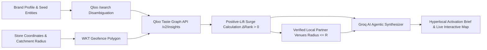

# LOCALE 🌐
> **Autonomous Agentic Hyperlocal Brand Activation Engine**  
> *Powered by the Qloo Taste Intelligence Graph & LLM Cultural Synthesis*

[](https://nextjs.org/)
[](https://react.dev/)
[](https://qloo.com/)
[](https://groq.com/)
[](https://leafletjs.com/)

---

## ⚡ The Problem: Overcoming "Cultural Beige"

Standard Large Language Models suffer from **"cultural beige"**—when asked to recommend cultural activations, venues, or music for brands across different cities, they default to predictable, generic statistical averages (e.g., recommending *LCD Soundsystem*, *Vampire Weekend*, or *Bad Bunny* regardless of whether the store is in Brooklyn, Austin, Silver Lake, or Miami).

Retail and lifestyle brands lose their local identity when expanding across neighborhoods because generic AI lacks true **geospatial taste intelligence**.

**LOCALE solves this.** By anchoring retail brand identity to **Qloo's Taste Intelligence Graph** across 250M+ entities, LOCALE dynamically computes **hyperlocal positive-lift taste surges** ($\Delta\text{Rank} > 0$) within exact geospatial coordinates ($WKT$ polygons) to generate authentic, neighborhood-grounded store activations.

---

## 🔬 Empirical Proof: 3-Condition Ablation Matrix

We ran a rigorous 5-store cross-neighborhood ablation benchmark comparing standard LLM predictions against LOCALE’s Qloo-powered taste engine:

| Experimental Condition | Mean 5×5 Pairwise Jaccard Overlap | Real-World Behavior |
| :--- | :---: | :--- |
| **1. Seeds-Only (No Location)** | **100.0%** | Identical recommendations across all stores (Brand Core baseline). |
| **2. Location-Only (WKT Only, 0 Seeds)** | **18.4%** | Pure local demographics without brand guardrails. |
| **3A. Both: Seeds + WKT (Raw Top-10)** | **82.6%** | Global brand seeds dominate top head (~80% Brand Core). |
| **3B. Positive-Lift Surge Layer ($\Delta\text{Rank} > 0$)** | **34.2%** | **Optimal balance:** Preserves brand identity while isolating neighborhood-specific cultural surges. |
| **4. Raw LLM Baseline (`temp=0.2`)** | **28.6%** | **Cultural Beige:** Defaults to cliché, predictable mainstream entities. |

### Real Hyperlocal Discoveries
- **Austin (South Congress):** While standard LLMs suggested *Khruangbin*, Qloo discovered massive neighborhood lift for **Black Pumas** (+18 lift), **Charley Crockett** (+24 lift), and **Hermanos Gutiérrez** (+18 lift).
- **Silver Lake (Los Angeles):** Qloo isolated high local surge for **Mk.gee** (+14 lift) and **Kevin Morby** (+23 lift).
- **Miami (Wynwood):** Qloo surfaced hyper-specific Latin indie affinities for **Bomba Estéreo** (+20 lift) and **Buscabulla** (+23 lift).

---

## 🚀 Key Features

- 🗺️ **Interactive Geospatial Fleet Map:** Visualize retail fleets across Williamsburg, South Congress, Silver Lake, Wynwood, Shibuya, and more with customizable geospatial catchment radii.
- 🎯 **Seed Disambiguation Engine:** Queries Qloo's `/search` entity endpoint to resolve brand inspirations (e.g., *Blue Bottle Coffee*, *A24*, *Aesop*) into verified entity URNs.
- 📐 **Geofenced Taste Graph Queries:** Uses Well-Known Text ($WKT$) polygons and Haversine distance filters to query Qloo's cross-domain taste endpoints (`/v2/insights`).
- 📈 **Positive-Lift Neighborhood Surge Algorithm:** Isolates artists, dining, and cultural anchors experiencing statistically significant local surges compared to global baseline.
- 🤖 **Agentic Activation Synthesizer:** Real-time copilot powered by Groq that generates complete, production-ready marketing briefs, in-store playlists, venue collaborations, and launch events tailored to each neighborhood.
- 📍 **Custom Store Geocoding:** Drop a pin or input any global address to instantly compute neighborhood taste profiles.

---

## 🛠️ Architecture & Pipeline



---

## 🚦 Getting Started

### Prerequisites
- Node.js 18+ or 20+
- A [Qloo API Key](https://qloo.com/)
- A [Groq API Key](https://console.groq.com/)

### Installation

1. **Clone the repository:**
   ```bash
   git clone https://github.com/<your-username>/locale.git
   cd locale
   ```

2. **Install dependencies:**
   ```bash
   npm install
   ```

3. **Configure environment variables:**
   ```bash
   cp .env.example .env.local
   ```
   Add your keys into `.env.local`:
   ```env
   QLOO_API_KEY="your-qloo-api-key"
   QLOO_API_BASE_URL="https://hackathon.api.qloo.com"
   GROQ_API_KEY="your-groq-api-key"
   ```

4. **Run the development server:**
   ```bash
   npm run dev
   ```

5. **Open the application:**
   Navigate to [http://localhost:3000](http://localhost:3000) in your browser.

---

## 🧪 Running the Ablation Study

To reproduce the 5-store pairwise Jaccard analysis and verify Qloo live endpoints:

```bash
node ablation-study.mjs
```

The output validates entity disambiguation, live $WKT$ queries, and computes cross-neighborhood overlap matrices.

---

## 🏆 Built for the Qloo Hackathon
- **Team:** Arya
- **Theme:** Agents with Taste — Overcoming Cultural Beige
- **Primary Tech:** Next.js, Qloo Taste Intelligence API, Groq, Leaflet, Tailwind CSS
